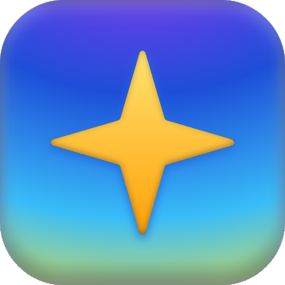

  

<h1 align="center">CES Compagnon</h1>

  L'application Windows du <strong>Corps Expéditionnaire Spatial</strong>, organisation francophone sur Star Citizen. 
  Ton jeu, le portail du CES et tes outils de vol, réunis dans une console tactique.

  
  
  
  

> Présentation complète, avec un aperçu des fenêtres : **[app.ces-sc.fr/compagnon/telecharger](https://app.ces-sc.fr/compagnon/telecharger)**
>
> **Réservée aux membres du CES et aux invités autorisés.** La connexion se fait avec ton compte du portail
> [app.ces-sc.fr](https://app.ces-sc.fr) : sans compte, l'application ne fait rien.

---

## Ce qu'elle fait

| | |
|---|---|
| 🛰️ **Le CES, en natif** | Opérations, « Ce soir », forum, annuaire, DEFCON, contrats du jeu et tes données, dans l'interface de l'application. |
| 🚨 **SOS** | Un appel à l'aide envoyé à tout le CES (portail, Discord, application), depuis la fenêtre ou au clavier sans quitter le jeu. |
| 🔔 **Notifications** | Notifications Windows et carte discrète en bas à droite du bureau : lancements de membres, alertes DEFCON, SOS. |
| 🎵 **Radio du CES** | L'antenne de l'organisation en direct, sur une platine vinyle ou une fenêtre flottante, pilotable depuis la barre des tâches. |
| 📓 **Carnet de voyage** | Sessions, sauts quantiques, lieux visités et missions tirés du journal du jeu, avec une carte stellaire de tes trajets. |
| 🇫🇷 **Traduction française** | Installe et met à jour la traduction communautaire du jeu, avec sauvegarde. |
| ⌨️ **Touches et personnages** | Profils de commandes partagés avec l'escadre, sauvegarde de tes personnages avec la photo de leur visage. |
| 💰 **Commerce, minage, Wikelo** | Routes commerciales (données UEX), sessions de minage avec lecture de l'écran de raffinerie, contrats de Wikelo avec leurs images. |
| 🎨 **À ton goût** | Tuiles déplaçables, navigation en haut, en bas ou à gauche, fond d'écran personnalisé, démarrage avec Windows. |

## Installation

1. Télécharge `CES-Compagnon_<version>_x64-setup.exe` dans la
   [**dernière version**](https://github.com/Kalgiio/ces-compagnon-releases/releases/latest).
2. Lance-le : l'installation se fait pour ton seul compte Windows, **sans droits administrateur**.
3. Si Windows affiche « Windows a protégé votre ordinateur » (l'application n'a pas encore de certificat de
   signature de code) : **Informations complémentaires → Exécuter quand même**.
4. Au premier lancement, clique sur **Se connecter** : le portail s'ouvre dans ton navigateur, tu t'y connectes comme
   d'habitude et tu approuves l'appareil. Aucun mot de passe n'est saisi dans l'application.

Les mises à jour suivantes arrivent **dans l'application**. Chaque paquet est signé, et sa signature est vérifiée
avant installation.

**Configuration :** Windows 10 ou 11, 64 bits. Star Citizen installé (dossier détecté tout seul, ou choisi à la main).

## Ton jeu et tes données

- **L'application ne touche pas au jeu.** Elle regarde si Star Citizen est lancé et lit les fichiers que le jeu écrit
  (journal, réglages, touches), comme un simple lecteur de fichiers. Aucune lecture de la mémoire du jeu, aucune
  injection, aucune interception réseau, aucune automatisation. Elle n'écrit dans le dossier du jeu que sur ta
  demande (traduction, touches, personnages), avec une sauvegarde.
- Les raccourcis SOS sont de simples raccourcis Windows (comme ceux de Discord ou d'OBS), désactivés par défaut.
- **Tu choisis ce qui est partagé**, type par type. Seuls **tes propres** événements partent vers le portail :
  jamais le journal brut, jamais d'information sur les autres joueurs.
- Ton jeton de connexion est rangé dans le **gestionnaire d'identification de Windows**, jamais dans un fichier.

## Code source

Le code de l'application est publié dans [`code/`](code) pour que chacun puisse voir ce qu'elle fait sur son PC.

| Dossier | Contenu |
|---|---|
| [`code/app/src`](code/app/src) | Interface (React, design system maison *CES Aurore Design*) |
| [`code/app/src-tauri`](code/app/src-tauri) | Cœur de l'application (Rust, [Tauri 2](https://tauri.app)) : jeu, traduction, touches, minage, Wikelo, notifications… |
| [`code/crates/sclog`](code/crates/sclog) | Lecture du journal de Star Citizen (`Game.log`) |
| [`code/tools/sclog-probe`](code/tools/sclog-probe) | Outil d'analyse du journal, en ligne de commande |

**Volontairement absent :** la partie qui relie l'application au portail du CES (appairage, jeton, relais des
appels, site embarqué). Le code publié ne se compile donc pas tel quel : les versions à installer sont celles des
[releases](https://github.com/Kalgiio/ces-compagnon-releases/releases), construites et signées par le CES.

### Licence

Code publié sous [**PolyForm Strict 1.0.0**](LICENSE.md) : tu peux le **lire, l'auditer et le tester** (usage non
commercial), mais **ni le modifier, ni le redistribuer, ni le réutiliser** dans un autre projet sans l'accord écrit du
CES. Pour une autorisation, passe par le Discord du CES. Les noms, logos et icônes du CES ne sont pas couverts.

## Remerciements

- Traduction française : [SCEFRA](https://github.com/SPEED0U/Scefra) (CC BY-NC-ND 4.0), installée telle quelle.
- Prix, terminaux et raffineries : [UEX](https://uexcorp.space) — données communautaires, sans garantie.
- Contrats et objets de Wikelo : [Star Citizen Wiki](https://star-citizen.wiki) (usage non commercial).

Un problème, une idée ? Passe par le Discord du CES.

---

Outil de fans **non affilié à Cloud Imperium Games**. Star Citizen®, Squadron 42®, Roberts Space Industries® et
Cloud Imperium® sont des marques de Cloud Imperium Rights LLC et Cloud Imperium Rights Ltd. *Made by the Community.*
